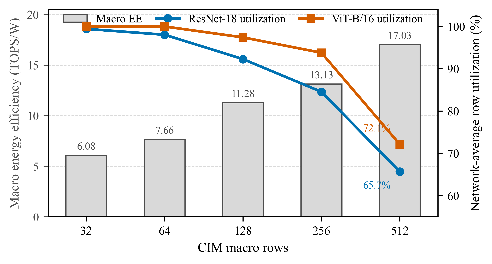
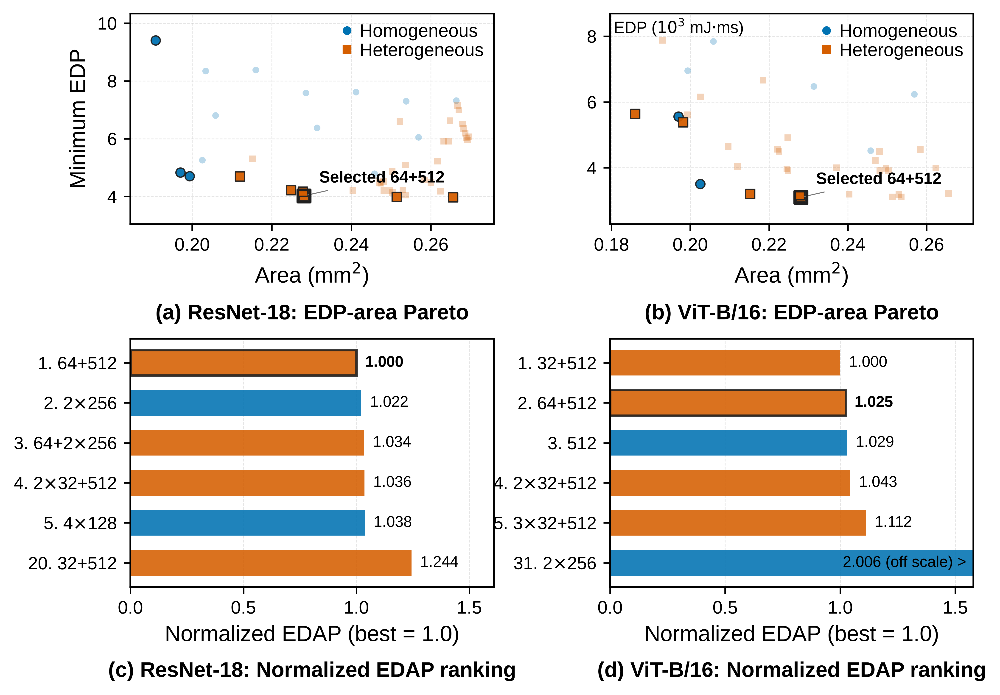

# II. 编译器表征驱动的异构 CIM Tile 探索

数字 CIM Macro 的设计通常追求更高的峰值能效与面效，但神经网络并不持续提供与物理阵列完全匹配的计算形状。本文关注的核心问题不是“哪一种 Macro 的峰值指标最高”，而是“如何将不同计算粒度组织为 Tile，使编译器表征得到的本征效率能够转化为工作负载级效率”。为此，本文提出一种编译器表征驱动的异构 CIM Tile 探索方法，将 Macro 组成与算子映射统一为一个受物理接口约束的多目标优化问题。

## A. 从本征效率到实现效率

本文使用开源数字 CIM compiler 表征 $32\times8$、$64\times8$、$128\times8$、$256\times8$ 和 $512\times8$ 五种 INT8 SRAM-CIM Macro。随着阵列行数增加，更多乘累加操作可以共享输入驱动、控制和局部累加开销，因此满负载能效由 6.08 TOPS/W 提高至 17.03 TOPS/W。该趋势说明大 Macro 具有更高的本征效率，但并不意味着它在真实网络中始终更优。

其根本原因是物理计算粒度与算子规约粒度之间的失配。对于规约维度为 $K_i$ 的算子，映射到 $R$ 行 Macro 后的行利用率为

\[
u_i(R)=\frac{K_i}{\lceil K_i/R\rceil R}.
\tag{1}
\]

增大 $R$ 一方面提高满阵列效率，另一方面也增大最后一个计算 wave 的碎片。因而，Macro 的工作负载级表现可以理解为两部分的乘积：由电路结构决定的本征效率，以及由张量形状和映射决定的实现效率。前者通常随阵列规模提高，后者则可能随计算粒度变粗而下降。二者的竞争解释了为何峰值 TOPS/W 最高的 Macro 不一定具有最低的网络能量或 EDP。

这一矛盾不能通过简单的平均利用率完全描述。未使用行不仅影响一次 VMM 的有效运算比例，还会改变 K-wave 数、特征重复加载、权重装载和 N 维并行机会。因此，利用率是粒度失配的表征，而不是最终优化目标。真正需要最小化的是在给定硬件接口下完成有效运算所付出的能量和时间。

CNN 与 Transformer 恰好呈现出明显的粒度多样性。宽规约卷积、线性投影和 FFN 能够充分使用大 Macro，而注意力矩阵乘、浅层卷积及尾部 wave 更适合较小阵列。由此得到本文的第一个洞察：**面向多形状工作负载，单一计算粒度难以同时保持高本征效率和高实现效率。**

如图 1 所示，Macro 行数增大时本征能效持续提高，但两个网络的平均行利用率并不随之同步提高，说明峰值能效与工作负载适配性之间存在结构性张力。

图 1：Macro 本征能效、ResNet-18 利用率与 ViT-B/16 利用率随 Macro 行数的变化。

## B. 异构 Tile 作为计算粒度配置问题

异构 Tile 不改变单个 Macro 的物理行数，而是让映射器在同一 Tile 内选择不同的规约粒度：宽规约计算使用大 Macro，以保留其高本征效率；小 $K$ 算子和尾部 wave 使用小 Macro，以减少无效行。因此，设计问题不是简单增加一种小 Macro，而是联合确定 Macro 组成、算子分工和并行方式，使两类资源的有效服务率与物理代价相匹配。

本文将 Tile 表示为 Macro 数量向量

\[
\mathbf n=(n_{32},n_{64},n_{128},n_{256},n_{512}),
\tag{2}
\]

其中 $n_R$ 为 $R$ 行 Macro 的物理数量。候选允许同构配置或至多两种 Macro 类型，并统一限制在以 0.4608 TOPS 为中心的 $\pm20\%$ 峰值算力窗口内，共形成 138 个理论候选。算力窗口阻止搜索通过无约束复制计算单元获得收益，但不强制候选具有相同面积；Macro 和寄存器面积仍作为独立代价进入优化。

对于工作负载 $w$、Tile 架构 $x$ 及其合法映射 $s$，本文求解

\[
\min_{x,s}\ \big(E(x,s,w),\ T(x,s,w),\ A(x)\big),
\qquad s\in\mathcal S(x,w),
\tag{3}
\]

其中 $x$ 表示物理组成，$s$ 表示工作负载 $w$ 上的合法映射。对形状为 $(P,K,N)$ 的算子，映射器将 $N$ 划分为 8 列输出块，并联合搜索 Macro 分组、$K$-wave 数量、输出块分配和 lane 数。同一 lane 内的多个 Macro 对 $K$ 维部分和进行归约，不同 lane 并行计算不同输出块；当 $K$ 超过分组总行数时，同一分组执行多个 wave。由此，架构组成会改变合法映射集合 $\mathcal S(x,w)$，映射又决定实际能量和延迟，二者不能分开优化。

三目标结果按 Pareto 支配关系保留；需要单一标量时使用
$\mathrm{EDAP}=E\times T\times A$，而不是用代理模型或峰值算力替代实际调度结果。这样既能显示面积、能量和延迟之间的权衡，也能解释为什么某个配置在 EDAP 排名中领先但不一定在每个单项指标上最优。

为避免大量小 Macro 从隐含接口中获得不公平优势，所有候选共享 4 条物理输出 lane、32 个输出/psum 寄存器以及相同的数据入口。特征和权重带宽分别固定为 512 bit/cycle 和 64 bit/cycle，二者在共享接口上互斥传输；同一 Macro 同一时刻只能执行一次 VMM。闲置 Macro 不产生动态计算能量，但其面积和静态功耗始终计入。这样，增加 Macro 实例只有在粒度适配收益能够覆盖资源与通信代价时才可能改善结果。

每次 VMM 的动态能量根据实际活动行数计算：

\[
E_q(r)=E_{\mathrm{fixed},q}+E_{\mathrm{row},q}r,
\qquad 0<r\le R_q,
\tag{4}
\]

其中固定项表示一次有效 VMM 不能随关闭行消失的开销，行相关项随活动行数 $r$ 变化；两项之和在 $r=R_q$ 时恢复 compiler 给出的满行能量。网络能量进一步加入输入/输出寄存器访问、部分和累加以及全 Tile 静态能量 $P_{\mathrm{static}}T$。因此，少用行不会带来理想的线性能量缩放，闲置物理资源也不能免费存在。

CNN 按层执行上述 $K$-wave 与 $N$-block 调度。对于 Transformer，搜索器进一步枚举互斥的投影 bank 和注意力 bank，以及 4 条 lane 在两者之间的合法划分；前者执行 Q/K/V/O 和 FFN，后者执行 $QK^T$ 与 $AV$。两类 bank 可并发工作，但共享数据接口仍按总传输量计时。在当前不计流水填充和排空的稳态模型下，Transformer 主体延迟为

\[
T_{\mathrm{tr}}=\max(T_{\mathrm{proj}},T_{\mathrm{attn}},T_{\mathrm{bus}}),
\tag{5}
\]

其中三项分别为投影计算路径、注意力计算路径和共享接口路径。单 Macro Tile 无法形成物理分区，其两类计算串行执行；多 Macro Tile 只有在两个 bank 的分工同时满足 lane 和总线约束时才能获得流水收益。小 Macro 的价值由此从“减少局部行碎片”扩展为“将注意力移出大 Macro 的串行关键路径”，过小或过多的辅助 Macro 则会暴露其本征效率和接口瓶颈。

完整求解采用两层搜索。外层 Bayesian optimization 从 138 个理论组成中选择需要实际评价的 Tile；内层使用带状态上限的 Pareto 动态规划，搜索 Macro 分组、$K$-wave、$N$-block、lane 分配及 Transformer bank 分工。代理模型只决定评价顺序，论文中的能量、延迟、面积和 Pareto 关系均来自实际调度结果，而不使用代理预测值。由此得到第二个洞察：**异构 Tile 的优势来自共享资源约束下的计算流平衡，而不是 Macro 数量、局部利用率或搜索算法本身。**

## C. 跨工作负载验证与设计洞察

本文使用 ResNet-18 和 ViT-B/16 验证上述分析。前者提供多尺度卷积规约维度，后者同时包含宽投影、FFN 与细粒度注意力，因而能够检验异构 Tile 对不同计算流的适配能力。两类网络均在相同的候选组成、物理 lane、片上存储和带宽约束下进行评价；ViT-B/16 的 Pareto 结论限定于实际完成调度的候选集合。

图 2 汇总了两类网络的 EDP--面积 Pareto 关系和归一化 EDAP 排名。图中不直接比较不同网络的绝对 EDAP，而是分别以各网络的最佳已评价配置归一化，从而突出架构选择对相对效率的影响；精确数值和完整候选列表保留在配套数据表中。

图 2：ResNet-18 与 ViT-B/16 的 EDP--面积 Pareto 前沿及归一化 EDAP 排名。

两组结果呈现出一致的结构性趋势：单一大 Macro 能够提供较高的本征能效，却会在细粒度规约和尾部 wave 中产生行碎片；完全同构的中等 Macro 虽然缓解了碎片，却无法同时承担宽规约算子的高吞吐需求。$64+512$ 通过功能分工保留 512 行 Macro 的宽规约效率，并将小规约和注意力流导向 64 行 Macro，使计算并行度、共享总线占用和面积开销达到更平衡的状态。

这一结论也解释了为何不能仅凭单个网络或单项指标选择 Tile。$32+512$ 代表更激进的细粒度适配，可能减少局部行浪费，但其吞吐和接口效率更容易成为瓶颈；$2\times256$ 代表同构复制，具有更规则的物理结构，却失去针对不同规约粒度进行分工的能力。因而，辅助 Macro 的尺寸不是孤立的器件参数，而是由工作负载形状、并行映射和面积目标共同决定的系统变量。

综合 Pareto 支配关系与跨网络归一化 EDAP 后，$64+512$ 在两个网络上均保持竞争力，并具有较小的最坏相对代价。本文由此得到第三个洞察：**稳健的异构 Tile 应位于粗粒度高效率与细粒度高适配性的平衡点，其选择应由跨工作负载的 Pareto 稳定性决定，而不能由单一 Macro 指标或单一网络结果决定。**

上述结果建立了从 Macro compiler 表征、工作负载粒度分布到 Tile 架构选择的因果链，也为后续 Core 级数据流和外围电路设计提供了明确的计算基元。
