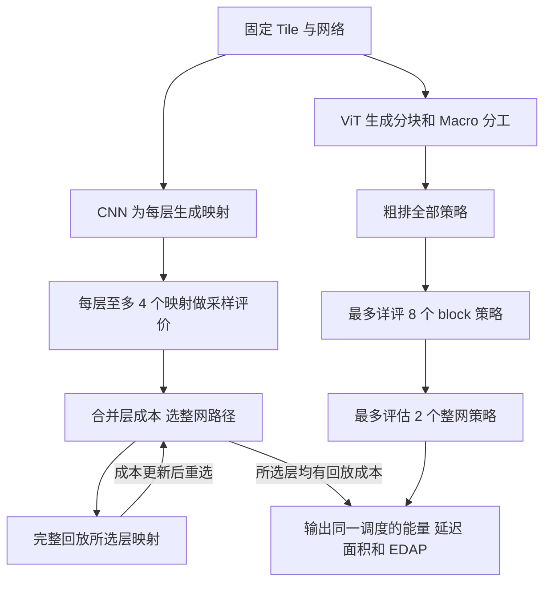

# 固定一个 Tile 后，如何在负载网络上搜索

假设外层已经给了一个 `64+512` Tile，里面有一个 64 行 Macro 和一个 512 行 Macro。内层搜索在这块硬件上给算子分配 Macro、划分工作并安排执行顺序，目标是让整网 EDAP 尽量低。每次内层搜索固定一块 Tile 和一个网络，最后交回一条经过验证的获胜调度及其整网成本。 [外层选点](OUTER_TILE_SELECTION.md) · [实验规范](TILE_DSE_EXPERIMENT_SPECIFICATION_V5.md)

| 负载 | 搜索什么 | 怎样确认整网成绩 |
|---|---|---|
| CNN，ResNet-18 和 VGG-16 | 每一层的 Macro 分组、输出通道分工和推进方式 | 合并各层成本选路径，再逐层完整回放并重选。 |
| ViT，ViT-B/16 和 ViT-L/16 | 注意力分块大小，以及投影和注意力怎样分配 Macro | 用一个 Transformer block 筛策略，再为入围策略调度和验证完整事件图。 |



EDAP 是整网能量 $E$、整网延迟 $T$ 和 Tile 本地面积 $A$ 的乘积。由于 $A$ 在这次搜索中固定，排序时比较 $E\times T$ 即可，结果仍以 EDAP 上报。共同面板取实际保留并通过验证的调度中 EDAP 最低的一条，$E$ 和 $T$ 都取自该调度。 [指标定义](TILE_DSE_EXPERIMENT_SPECIFICATION_V5.md#6-指标与通过标准) · [内层参数](../../RUN/tile_DSE/v5/inner_search.py#L16)

## 1. CNN 逐层找映射，再选整网路径

### 1.1 先确定这一层要算什么

卷积可以按 GEMM 理解。$P$ 是有多少个输出位置，$N$ 是每个位置有多少个输出通道，$K$ 是算出一个输出值需要累加多少项。以 ResNet-18 的 `T1` 为例，输出特征图是 `56×56`，输入和输出各有 64 个通道，卷积核是 `3×3`。所以 `P=3136`、`K=576`、`N=64`。 [负载形状](../../SRAM_config/v5_workloads/resnet18_224.json) · [负载加载](../../RUN/tile_DSE/v5/mapping.py#L120)

搜索还保留实际的核大小、步幅和 padding。评价器用这些信息判断每项输入从哪里取、哪些值可由 padding 补零，以及 `3×3` 卷积怎样用双行缓冲供数。全连接层直接用负载给出的 $P,K,N$。非 CIM 操作按实验协议由外部服务处理。 [卷积扫描](../../RUN/tile_DSE/v5/geometry.py#L46) · [CNN 映射规范](TILE_DSE_EXPERIMENT_SPECIFICATION_V5.md#4-cnn映射)

### 1.2 给每条 lane 分 Macro，再用 `jobs` 分输出

**同一条输出 lane 上的 Macro 合算一个输出块。** 一条 lane 是一条硬件输出通路，可以由一组 Macro 共用。组内每个 Macro 分担归约长度 $K$ 中的一段，最后在组内归约。以 `T1` 为例，把 64 行和 512 行 Macro 放进同一条 lane，合计 576 行，刚好一波覆盖 `K=576`。若一条 lane 只有 512 行，剩余的 64 项要在下一波计算。不同 lane 则沿 $N$ 维分工，各自负责不同的输出通道。每个 Macro 至多分给一条 lane，也可以闲置。 [分组生成](../../RUN/tile_DSE/v5/search.py#L76) · [物理映射校验](../../RUN/tile_DSE/v5/mapping.py#L53)

**`jobs` 记录每条 lane 负责多少个连续的输出块。** 每块最多 8 个通道，因此块数 `B=⌈N/8⌉`。以 64 个输出通道为例，共 8 块。如果两条 lane 的 `jobs=[3,5]`，第一条负责通道 `0–23`，第二条负责通道 `24–63`。 [通道块分配](../../RUN/tile_DSE/v5/search.py#L84)

lane 签名是**这条 lane 里各尺寸的 Macro 各有几个**。签名决定枚举哪些 `jobs`。 [分工枚举](../../RUN/tile_DSE/v5/search.py#L84)

| 分组示例 | 8 个输出块怎样分 |
|---|---|
| 两条 lane 各用一个 256 行 Macro，签名相同 | 均分成 `[4,4]`。有余数时尽量均分。 |
| 一条用 64 行 Macro，另一条用 512 行 Macro，签名不同 | 枚举 `[1,7]`、`[2,6]`、……、`[7,1]`，让后续评价比较各自成本。 |
| 三条 lane 中，两条各用一个 64 行 Macro，另一条用一个 512 行 Macro | 先给两种签名分块，再在同签名的两条 lane 之间均分。例如 512 行 Macro 拿 3 块，两个 64 行 Macro 分到 2 块和 3 块。按这个 lane 顺序就是 `jobs=[3,2,3]`。 |

每条活跃 lane 至少拿到 1 块。生成器在一个映射里最多使用两种签名，同一种签名可以出现在多条 lane 上。异构分组还会比较同步推进和独立推进。同步推进时各组按共同轮次执行，可共享符合条件的输入广播。独立推进时各异构组可以按各自节奏前进，仍共用实际的通路带宽。 [分组生成](../../RUN/tile_DSE/v5/search.py#L76) · [调度变体](../../RUN/tile_DSE/v5/search.py#L116)

### 1.3 用通道配额筛掉活跃 lane 过多的映射

**配额回答的是当前映射最多能同时启用几条 lane。** 假设 Tile 装有 4 条 lane，待检查的映射给每条 lane 分了一个 128 行 Macro。这个映射请求启用 4 条 lane，已安装 lane 数 `L=4`。四组的行容量都是 128，所以取最小值 `Ktile=128`。再假设该层需要算 32 个输出通道，共 `B=4` 块，归约长度 `K=576`。 [配额实现](../../RUN/tile_DSE/v5/channel_quota.py#L25)

配额规则从级别 `0` 开始，级别 0 的规则按每个参考分区 4 个 Tile 的覆盖量计算。每升一级就把参考分区数减半，并把规则里的 K 覆盖量翻倍。把 4 个输出块尽量均分给当前级别的分区，再看哪个分区拿到最多块。 [配额实现](../../RUN/tile_DSE/v5/channel_quota.py#L32)

| 级别 | 参考分区数 | 各分区的块数 | 规则计算的 K 覆盖量 | 这个例子怎么走 |
|---|---:|---|---:|---|
| `0` | 4 | `[1,1,1,1]` | `4×128=512` | 最大配额 1 块，且 `512<576`，升一级。 |
| `1` | 2 | `[2,2]` | `8×128=1024` | 因为 `1024≥576`，在这一级停止。 |

停下时，最大分区配额是 2 块，和已安装的 4 条 lane 取较小值，得到上限 **2 条 lane**。原映射请求 4 条，因此被筛掉。若另一个映射使用两条 lane、每条仍用一个 128 行 Macro，它会得到同样的 2 条上限，可以通过这一项检查。最终评价按该映射的 `jobs` 在一个 Tile 上算完所有位置、所有通道和全部 576 项归约。 [配额判定](../../RUN/tile_DSE/v5/channel_quota.py#L37) · [配额筛选](../../RUN/tile_DSE/v5/search.py#L130)

**通用规则。** 对每个待检查映射，`Ktile` 取活跃 lane 中最小的组内行容量。级别 `0`、`1`、`2` 对应的参考分区数依次为 `4`、`2`、`1`，K 覆盖量依次为 `4×Ktile`、`8×Ktile`、`16×Ktile`。满足下列任一条件就停止，取 `min(L, 最大分区块数)` 作为该映射的活跃 lane 上限。 [配额实现](../../RUN/tile_DSE/v5/channel_quota.py#L25)

- 最大分区块数已达到已安装 lane 数 `L`。
- 规则计算的 K 覆盖量已达到该层的 `K`。
- 已到级别 `2`。

### 1.4 每层先粗筛，再用代表位置评价

1. **粗筛到最多 4 条。** `PrescreenModel` 根据有效输入、活动行、权重更新、寄存器、归约、部分和与 GB 访问估算能量和延迟。程序分别保留估计能量最低、延迟最低、EDP（能量 × 延迟）最低和同步映射中 EDP 最低的方案，去重后按 EDP 补足名额。粗筛省略部分启动和资源相位，用于排序。 [预筛模型](../../RUN/tile_DSE/v5/shortlist.py#L423) · [短名单规则](../../RUN/tile_DSE/v5/shortlist.py#L446)
2. **用代表位置细化成本。** 卷积初始最多取 8 个位置，覆盖角、边和内部。代表点按各类位置在整张特征图上的实际数量加权，小图直接全取。固定权重加载按实际波次和输出块计费。没有空间几何的 GEMM 初始也最多评价 8 个位置，再按位置数估算。每层保留整个短名单供整网选择。 [加权采样](../../RUN/tile_DSE/v5/weighted_sampling.py#L21) · [层级评价](../../RUN/tile_DSE/v5/search.py#L256)

### 1.5 合并层成本，回放后重选路径

**一条整网路径为每个 CIM 层各选一个映射。** 模型按顺序执行这些层，所以路径的总能量和总延迟分别是各层能量之和与各层延迟之和。整网比较的是这两个总数相乘。例如当前一层可以选低能耗或低延迟，后续层已经花掉很多能量时，在当前层节省一点延迟，可能更能降低整网 $E\times T$。 [整网前沿](../../RUN/tile_DSE/v5/search.py#L432)

程序从总能量和总延迟均为 0 的空路径开始。每加一层，就把现有路径与该层的短名单逐一组合。如果另一条路径的能量和延迟都更低或持平，且至少一项有改善，就删去被支配的路径。留下的就是 **E–T 前沿**。若前沿超过 512 条，会按延迟改善比例压缩，初始阈值为 `0.001`，同时保留当步 $E\times T$ 最低的状态。最后取整网 EDAP 最低的路径。最多 4 个软件进程可以并行评价各层，模型里的层成本按串行相加。 [路径合并](../../RUN/tile_DSE/v5/search.py#L432) · [前沿压缩](../../RUN/tile_DSE/v5/frontier.py#L5) · [层评价进程](../../RUN/tile_DSE/v5/search.py#L534)

**校准就是用完整回放的成本替换采样成本。** 共同面板先校准首层、末层和 $P$ 发生变化的层，再把范围扩到所选路径的全部层。两阶段用同一个循环。 [运行入口](../../RUN/tile_DSE/v5/run_search.py#L186) · [校准范围](../../RUN/tile_DSE/v5/calibration.py#L138)

1. 找出当前获胜路径上还没有完整回放的映射。
2. 用该层全部输出位置和真实扫描顺序回放，更新能量、延迟和访问账本。
3. 用新成本重算整网前沿。如果新路径选中了尚未回放的映射，就继续。所选路径的每一层都有完整回放时结束。 [重选循环](../../RUN/tile_DSE/v5/calibration.py#L178)

采样误差超过 5% 时，校准还可把诊断采样额度逐步增至 64 个位置。最终整网成本始终取完整回放的值。 [成本替换](../../RUN/tile_DSE/v5/calibration.py#L31)

### 实例 `64+512 × ResNet-18`

`T1` 有 17 个通过物理和配额检查的调度候选。整网获胜路径用同一条 lane 的两个 Macro 合算 `K=576`，`jobs=[8]` 表示这条 lane 负责全部 64 个输出通道。一波即可算完归约，跨波次部分和读写为 0。 [搜索记录](../../results/tile_DSE/v5/e04_development48_250mhz_bus4_20261117/1xm64x8+1xm512x8/resnet18/search.json)

| 回放记录 | 搜索中发生了什么 |
|---|---|
| `T1` | 8 点采样估计 `0.923072 ms`，完整回放得到 `0.958784 ms`，后者写入整网成本。 |
| `T12` | 两套双 lane 分工先后进入回放，`jobs` 分别为 `[22,10]` 和 `[21,11]`，最终选回 `[22,10]`。 |
| 整网 | 4 轮校准留下 28 条层映射回放记录，最终路径的 21 个 CIM 层均有完整回放。 |

同一层可以有多条回放记录，因为重选路径时可能试用该层的另一种分工。 [层回放证据](../../results/tile_DSE/v5/e04_development48_250mhz_bus4_20261117/1xm64x8+1xm512x8/resnet18/representative_replay.json)

## 2. ViT 同时选注意力分块和 Macro 分工

### 2.1 先决定每次处理多少 token

这里有两种块。**注意力分块**是一次送入注意力算子的一段 token。**Transformer block** 是网络反复执行的一组投影、注意力和 FFN 算子，ViT-B/16 有 12 个。搜索遍历 `Bq` 和 `Bk` 的取值，每个都可选 `32、64、128、192`，共 16 对。 [网络形状与建图](../../RUN/tile_DSE/v5/vit_graph.py#L30) · [分块遍历](../../RUN/tile_DSE/v5/vit_hierarchical.py#L210)

以 192 个 token 为例，`(Bq,Bk)=(64,128)` 把查询分成 `64+64+64`，把 KV 分成 `128+64`。每个查询块要先后利用两个 KV 块，因此 AV 要保存并读回中间的 32-bit 状态，再写出最终的 8-bit 结果。`(192,192)` 只有一个 KV 块，每个查询块可直接得到最终输出。`Bk` 还会改变 AV 的归约长度，所以需要结合实际 Macro 行容量一起选。 [ViT 建图](../../RUN/tile_DSE/v5/vit_graph.py#L63) · [KV 状态计费](TILE_DSE_EXPERIMENT_SPECIFICATION_V5.md#5-vit映射与kv状态)

对实际长度为 $b_q,b_k$ 的一对块，$QK^{\mathsf T}$ 的 $(P,K,N)=(b_q,64,b_k)$，AV 的 $(P,K,N)=(b_q,b_k,64)$。尾块按实际长度建图，每个 head 的 Q、K、V 都就绪后才开始该 head 的注意力。 [算子形状和依赖](../../RUN/tile_DSE/v5/vit_graph.py#L78)

### 2.2 再决定各类算子用哪些 Macro

| 模式 | Macro 如何分配 |
|---|---|
| `serial` | 所有角色共用 `full` 映射。依赖和共享资源决定实际执行次序。 |
| `partitioned` | Q/K/V 使用 `projection`，注意力使用 `qk` 和 `av`。投影与注意力使用互斥的 Macro，因而不同 head 的投影和注意力可以重叠。QK 和 AV 可以使用不同的注意力 Macro。 |

在 `partitioned` 模式下，patch 投影、输出投影 O、FFN 和分类头仍用 `full` 映射，可以跨分区使用已安装的 Macro。每种分块最多生成 64 个结构化提案，再从布局枚举中取最多 32 个 `serial` 和 32 个 `partitioned` 策略，按具体映射去重。候选覆盖不同 lane 数、按 Macro 类型分区及用固定种子 `7` 构造的布局变体。 [策略路由](../../RUN/tile_DSE/v5/mapping.py#L69) · [候选池](../../RUN/tile_DSE/v5/vit_hierarchical.py#L107)

同一策略可按组内行容量或预估单组服务时间的倒数分配输出块，再用最大余数法取整。QK 和 AV 等角色的算子形状不同，所以同一分工规则可能分出不同的块数。 [算子映射解析](../../RUN/tile_DSE/v5/mapping.py#L27) · [输出块分配](../../RUN/tile_DSE/v5/job_allocation.py#L23)

### 2.3 先评一个 Transformer block，再评整网

| 阶段 | 做什么 | 怎样用结果 |
|---|---|---|
| 粗排全部策略 | 按算子依赖、Macro/lane 占用以及入口和输出负载，估算一个 block 和首尾算子的成本。 | 用粗排 EDAP `Q_cheap` 初步判断哪些策略值得详评。 |
| 详评最多 8 个 block 策略 | 编译、调度并校验一个完整 Transformer block 及首尾算子。首尾算子按 `full` 映射复用详评结果。 | 用 `Q_block` 重排这些策略，并用它与 `Q_cheap` 的差距分配后续详评名额。 |
| 评估最多 2 个整网策略 | 按 `Q_block` 从低到高取入围策略，编译 patch、所有 Transformer blocks 和分类头，调度并校验完整整网事件图。 | 从通过校验的策略中选择整网 EDAP `Q_full` 最低的一条。 |

粗排和单 block 详评都把首尾算子加一次，一个 Transformer block 的成本乘以网络的 block 数 $D$。能量和延迟分别求和，再相乘并乘以面积。例如用能量表示就是 $E_{\rm patch}+D\,E_{\rm block}+E_{\rm cls}$。区别在于前两个阶段分别用粗筛模型和单 block 事件评价取得成本，最终成绩来自整网事件评价。 [粗筛模型](../../RUN/tile_DSE/v5/vit_hierarchical.py#L29) · [单 block 评价](../../RUN/tile_DSE/v5/vit_hierarchical.py#L260) · [整网评估](../../RUN/tile_DSE/v5/vit_hierarchical.py#L345)

**8 个 block 名额怎样分配。** 先把粗排中最好的串行策略、最好的分区策略，以及 `(32,32)` 和 `(192,192)` 各自的最好策略去重后详评。剩下的名额借助已观测的粗筛误差，优先给校正后最有希望的方案。缺少同类观测的候选会获得更大的乐观余量，仍有机会进入详评。 [初始代表策略](../../RUN/tile_DSE/v5/vit_hierarchical.py#L298) · [误差校正](../../RUN/tile_DSE/v5/vit_hierarchical.py#L310)

**整网怎样提速。** 若各 block 的前序屏障、事件结构、资源、周期和出口边界都与已调度的模板相符，可以平移模板得到整网轨迹。检查失败时由资源调度器重新定时。两种方式都会编译完整事件图，仍按全图计费和校验。 [整网评价](../../RUN/tile_DSE/v5/vit_hierarchical.py#L233) · [模板复用条件](../../RUN/tile_DSE/v5/vit_repeated_blocks.py#L26)

### 2.4 校正和早停怎样计算

单 block 详评后，记对数误差 $r=\ln(Q_{\rm block}/Q_{\rm cheap})$。给待选策略估计误差时，先找相同分工策略在其他分块上的观测，找不到就用同模式的观测。设 $\mu$ 为这些误差的均值，缺少观测时取 0。设 $m$ 为向下给出的乐观余量，基础值取 $\ln(1.10)$ 和误差对均值最大偏差中的较大值。缺少同策略样本、该分块对尚无成功详评时，各加 $\ln(1.15)$。比较 $Q_{\rm cheap}e^{\mu-m}$，优先尝试数值最低的方案。 [误差校正](../../RUN/tile_DSE/v5/vit_hierarchical.py#L310)

快档允许提前停下。这里的 5% 是分配评价名额的启发式阈值，实际的搜索差距要靠高预算配对评价测量。 [搜索停机条件](../../RUN/tile_DSE/v5/vit_hierarchical.py#L323) · [配对评价](SEARCH_METHOD.md#高预算配对方法与历史记录)

| 阶段 | 何时可以早停 |
|---|---|
| block 详评 | 至少 6 条已成功详评，并且剩余候选中最乐观的估计仍不低于 `当前最佳 Q_block / 1.05`。 |
| 整网详评 | 至少有一条通过整网评价。用已观测的 $\ln(Q_{\rm full}/Q_{\rm block})$ 校正下一条的预估，下调余量至少取 $\ln(1.01)$。若校正后仍不低于 `当前最佳 Q_full / 1.05`，可以停下。 |

### 实例 `64+512 × ViT-B/16`

在 16 对分块下各生成 17 条去重策略，共 **272 条粗筛候选 → 8 条完成 block 详评 → 1 条完成整网评价**。第二个整网名额因经验余量早停。获胜策略用 `(Bq,Bk)=(192,192)` 和 `partitioned`。512 行 Macro 执行 Q/K/V、O、FFN、patch 投影和分类头，64 行 Macro 执行 QK 和 AV。整网共 1,395 个算子节点和 66,791 条事件记录，采用重复 block 模板并通过整网校验。 [分块与策略审计](../../results/tile_DSE/v5/e04_development48_250mhz_bus4_20261117/1xm64x8+1xm512x8/vit_b16/search.json) · [获胜回放](../../results/tile_DSE/v5/e04_development48_250mhz_bus4_20261117/1xm64x8+1xm512x8/vit_b16/best_replay.json)

## 3. 怎样读验证结果和预算

评价器把任务编译成权重写入、输入搬运、VMM、归约、部分和读写及输出事件。轨迹校验检查依赖与资源占用，内容回放检查 VMM 是否读到正确的权重和输入、暂存是否在排空前被覆盖、跨 KV 状态是否按步次更新。延迟用结束周期乘以 `4 ns`。能量包括计算与本地组件、总线与 GB 动态访问及全部已安装 Macro 在调度时间内的静态能量。 [事件评价](../../RUN/tile_DSE/v5/batch_evaluator.py#L373) · [轨迹校验](../../RUN/tile_DSE/v5/resources.py#L320) · [内容回放](../../RUN/tile_DSE/v5/evaluator.py#L409)

| `64+512` 的获胜调度 | 能量（mJ） | 延迟（ms） | 本地面积（mm²） | EDAP（J·s·mm²） |
|---|---:|---:|---:|---:|
| ResNet-18 | 0.384158 | 24.653904 | 0.373928 | `3.541470e-6` |
| ViT-B/16 | 4.134905 | 224.578576 | 0.373928 | `3.472335e-4` |

计算 EDAP 时先把 mJ、ms 转为 J、s。例如 ResNet-18 为 $(0.384158\times10^{-3})(24.653904\times10^{-3})(0.373928)\approx3.541470\times10^{-6}$ J·s·mm²。每个网络的获胜 EDAP 各自交回外层用于打分。 [整网成本汇总](EXPERIMENT_CONCLUSION.md#64512-的整网模型成本) · [外层如何使用单网成绩](OUTER_TILE_SELECTION.md)

| 想查什么 | 看哪个产物 |
|---|---|
| 这次用了哪块 Tile、哪个负载和哪些参数 | `manifest.json`，包括输出 lane、预算和源码指纹。 |
| CNN 每层选了什么 | `search.json` 的 `aggregate.best` 给获胜路径，`selected_layer_measurements` 给各层成本。`representative_replay.json` 保存所有已校准映射的采样和完整回放记录。 |
| ViT 哪些策略入围、何时早停 | `search.json` 的 `prescreens` 和 `stopping`，获胜成本在 `best` 和 `best_replay.json` 中。 |
| ViT 如何排程 | `best_events.json` 给出完整事件及依赖，`best_trace.json` 给出周期、资源占用和动作细节。 |
| 评价是否完成 | `status.json`。CNN 查 `full_spatial_network_front_complete` 和 `fully_replayed_selected_path=true`。ViT 查 `validation_search_complete` 和 `replay_consistency`。 |

共同控制器还会核对冻结参数、负载、物理面积、工作量、能量账本和产物哈希。已结案面板按下表限制计算量。 [内层准入](../../RUN/tile_DSE/v5/inner_search.py#L105) · [控制器校验与时限](../../RUN/tile_DSE/v5/run_e04.py#L243) · [面板预算](TILE_DSE_EXPERIMENT_SPECIFICATION_V5.md#7-外层选点与交付)

| 评价单元 | 预算 |
|---|---|
| CNN 每层 | 至多 4 个入围映射，每次事件评价上限 800,000 条。`--evaluation-budget 2000` 是通用的每层映射评价上限。 |
| ViT 单 block 详评 | 最多尝试 8 条策略，单图事件上限 100,000 条。 |
| ViT 整网详评 | 最多尝试 2 条策略。单图事件上限为 ViT-B/16 800,000 条、ViT-L/16 1,900,000 条。 |
| 共同面板的单个 Tile × 网络任务 | 派发后 600 秒，包含搜索、回放、校验和哈希。墙钟超时与事件额度耗尽分开记录，通过准入的完整结果才参与外层打分。 |

## 4. 单独运行同一块 Tile

从仓库根目录进入已配置的 `cim-dse` 环境，使用新的空输出目录。下面分别运行 `64+512 × ResNet-18` 和 `64+512 × ViT-B/16`，沿用共同面板的关键内层参数。单候选入口的运行时长由调用方管理，共同面板的时限由控制器实施。 [环境配置](../../ENVIRONMENT.md) · [运行说明](../../RUN/tile_DSE/v5/README.md#单候选诊断)

```bash
export PYTHONDONTWRITEBYTECODE=1 OPENBLAS_NUM_THREADS=1
V5=experiments/RUN/tile_DSE/v5
WORKLOADS=experiments/SRAM_config/v5_workloads
OUTPUT=experiments/results/tile_DSE/v5/single_tile_64_512_new
DESIGN='1xm64x8+1xm512x8'

python "$V5/local_runtime.py" "$V5/run_search.py" \
  --design "$DESIGN" --workload-json "$WORKLOADS/resnet18_224.json" \
  --output-dir "$OUTPUT/resnet18" --max-output-lanes 4 \
  --balanced-search --weighted-sampling --network-front --channel-quota \
  --cnn-calibration-scope all --cnn-layer-workers 4 \
  --event-budget 800000 --evaluation-budget 2000

python "$V5/local_runtime.py" "$V5/run_search.py" \
  --design "$DESIGN" --workload-json "$WORKLOADS/vit_b16.json" \
  --output-dir "$OUTPUT/vit_b16" --max-output-lanes 4 \
  --query-blocks 32,64,128,192 --kv-blocks 32,64,128,192 \
  --vit-search-method hierarchical --vit-search-seed 7 \
  --vit-per-block-policy-budget 64 --vit-exact-budget 8 \
  --vit-full-network-top-k 2 --vit-quality-target 0.05 \
  --vit-reuse-finalist --vit-block-cache \
  --event-budget 800000 --evaluation-budget 2000
```
