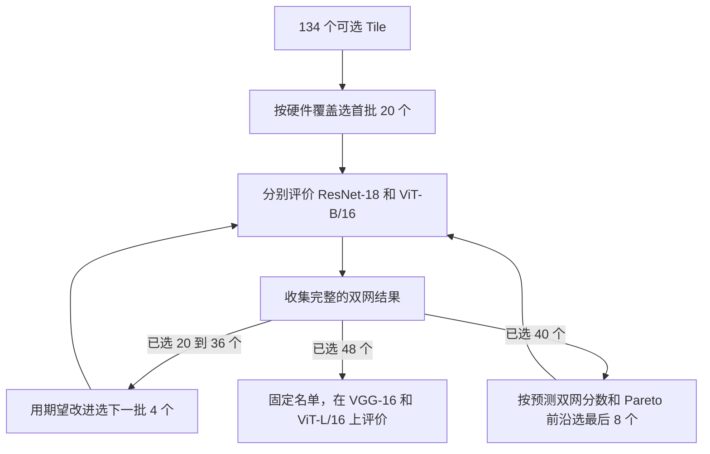

# 外层 DSE 如何从 134 个 Tile 中选出 48 个

假设首批已经评价完，下一轮有 4 个评价名额。外层搜索要决定的就是这 4 个名额给谁。一个 Tile 的身份由各尺寸 Macro 的数量确定。比如 `64+512` 由一个 64 行和一个 512 行 Macro 组成。外层点名后，内层分别为这个固定硬件搜索 ResNet-18 和 ViT-B/16 的映射，回传通过验证的整网成本。下一批选点就用这些成本。 [搜索方法](SEARCH_METHOD.md) ・ [开发组控制器](../../RUN/tile_DSE/v5/run_e04.py#L389)



## 外层 Tile 选点算法

**输入**是冻结的 134 个候选 Tile。**输出**是按选入顺序排列的 48 个 Tile。`已选` 记录已经分配的名额，`观测` 记录 ResNet-18 和 ViT-B/16 都完成评估的 Tile。每批等两网任务都进入终态再推进。超时或耗尽事件额度的 Tile 占用原名额，只有完整双网结果进入 `观测`。

```text
外层选点(候选池)
    已选 ← 按名称排序的 10 个同构 Tile，再依次加入 32+512、64+512、128+512
    等算力池 ← 候选池中峰值算力为 0.288 TOPS 的 Tile
    用整个等算力池计算 Macro 总数跨度 ΔN 和面积跨度 ΔA

    重复 7 次
        从等算力池中尚未入选的点里，优先选 Macro 尺寸搭配尚未覆盖的点
        同优先级时，选到最近已选点的归一化距离平方 D_init 最大的点
        把该点加入已选
    观测 ← 对首批 20 个做双网评价，收集两网都完成的结果

    重复 5 批
        待选 ← 候选池中所有未入选的点
        本批 ← 选 EI 批次(待选, 观测)
        把本批 4 个加入已选，对它们做双网评价，更新观测

    待选 ← 候选池中所有未入选的点（94 个）
    本批 ← 选末轮批次(待选, 观测)
    把末轮 8 个加入已选，并对它们做双网评价
    返回已选的 48 个 Tile

选 EI 批次(待选, 观测)
    如果观测为空，按名称取待选的前 4 个并返回
    用观测重算每个训练 Tile 的双网对数分数 ln(G)
    当前最好 ← 真实训练分数的最小值，本批内固定
    批内训练数据 ← 真实训练数据的副本
    本批 ← 空名单
    重复 4 次
        拟合 RBF 高斯过程，预测每个待选点的均值 μ 和标准差 σ
        用 μ、σ 和当前最好计算 EI，选 EI 最大的点
        把该点加入本批，并从待选移除
        如果本批还没选满，从该点的预测分布 N(μ, σ�0�5) 抽一个临时分数
            将该点及临时分数加入批内训练数据，供下一个名额重新拟合
    返回本批

选末轮批次(待选, 观测)
    如果观测为空，按名称取待选的前 8 个并返回
    拟合双网对数分数 ln(G)，按预测均值从小到大排序
    本批 ← 预测均值最低的 4 个点
    为每个待选点 c 计算坐标 p(c) = (p_E(c), p_T(c), ln(A_c))
        p_E 和 p_T 来自能耗、延迟的双网预测，A_c 来自候选表
    前沿候选 ← 空名单
    对每个尚未进入本批的点 c
        依次检查待选中的其他点 d（包含本批已有的 4 个点）
        如果 d 的三项指标都不大于 c，且至少一项更小
            c 被支配，停止检查 c
        如果找不到这样的 d，把 c 加入前沿候选
    按所有 94 个待选点的极差，把三个坐标分别缩放到 [0, 1]
    当本批少于 8 个且前沿候选非空
        对每个前沿候选，求它到本批已选点的最近欧氏距离
        取最近距离最大的点，加入本批并从前沿候选移除
    若还未选满 8 个，依预测均值排名补齐
    返回本批
```

高斯过程的输入用整个候选池的五列 Macro 数量统一缩放。选点或排序遇到并列时按 Tile 名称排序。EI 批内抽样的随机种子由固定种子 `7` 和本轮完整双网样本的名称确定。末轮评估回传后，VGG-16 与 ViT-L/16 也在这 48 个 Tile 上评价，最终使用四网整网回放结果评分。 [首批选点](../../RUN/tile_DSE/v5/panel.py#L10) ・ [批次控制](../../RUN/tile_DSE/v5/campaign.py#L55) ・ [EI 批次](../../RUN/tile_DSE/v5/joint_bo.py#L62) ・ [末轮批次](../../RUN/tile_DSE/v5/joint_bo.py#L90)

## 1. 首批 20 个按硬件组成选

`prepare.py` 按五种 Macro 的数量枚举候选。设 $n_r$ 是 Tile $c$ 中 $r$ 行 Macro 的数量。以一个 32 行 Macro 的 `0.016 TOPS` 为单位，Tile 的算力由下式给出。

$$
P(c)=0.016\bigl(n_{32}+2n_{64}+4n_{128}+8n_{256}+16n_{512}\bigr)\quad\text{TOPS}.
$$

算力窗口是 $0.288\times[0.8,1.2]=[0.2304,0.3456]$ TOPS，所以括号里允许的整数是 15 到 21。最多两种 Macro 数量可以大于零，枚举得到 $14+124=138$ 个配置。按偶数规则去掉纯 32 行的 `15×32`、`17×32`、`19×32`、`21×32` 后，冻结 **134 个可选 Tile**。控制器获得运行结果前，先按以下顺序选 20 个。 [候选池约束](TILE_DSE_EXPERIMENT_SPECIFICATION_V5.md#2-物理候选和资源) ・ [冻结的 134 点候选表](../../results/tile_DSE/v5/preparation_250mhz_bus4_development_20261117/candidates_134.csv)

1. **10 个同构 Tile 全选。** 每个 Tile 只用一种 Macro 尺寸，例如 `2×256`。
2. **加入 3 个指定的异构对照。** 分别是 `32+512`、`64+512` 和 `128+512`。因此 `64+512` 从一开始就占有一个评价名额。
3. **从严格 `0.288 TOPS` 的点里补 7 个。** 优先覆盖还没入选的 Macro 尺寸搭配。优先级相同时，用 Macro 总数和 Tile 本地面积量距离。两维先按等算力候选的取值跨度缩放，再找与已选点中最近者距离最大的候选。比如第一个补入的 `8×32+5×64` 有 13 个 Macro，算力是 `8×0.016 + 5×0.032 = 0.288 TOPS`。

设 $N_c$ 是 Tile $c$ 的 Macro 总数，$A_c$ 是本地面积，$B$ 是已选名单。第三步使用下式作为同优先级候选的比较值，选 $D_{
m init}$ 最大的点。$\Delta_N$ 和 $\Delta_A$ 各取严格等算力子集对应列的最大值减最小值，跨度为零时用 1 作分母。 [首批选点代码](../../RUN/tile_DSE/v5/panel.py#L26)

$$
D_{\rm init}(c)=\min_{b\in B}\left[
\left(\frac{N_c-N_b}{\Delta_N}\right)^2+
\left(\frac{A_c-A_b}{\Delta_A}\right)^2\right].
$$

首批 20 个都在两个开发网络上评价，共派发 40 个任务。原开发批次的首轮有 31 项完成、9 项超时，其中 **12 个 Tile 两网都完成**。这 12 个 Tile 构成第一次拟合的训练集。超时项保留原来的选点名额，后续补测沿用原名单。 [首批选点代码](../../RUN/tile_DSE/v5/panel.py#L10) ・ [首批名单](../../results/tile_DSE/v5/preparation_250mhz_bus4_development_20261117/initial_panel.csv) ・ [原开发批次状态](../../results/tile_DSE/v5/e04_development48_250mhz_bus4_20261117/state.json)

## 2. 每个已评估 Tile 怎么得到一个双网分数

设 $c$ 是 Tile，$w$ 是网络，$\mathcal S(c,w)$ 是通过验证的整网调度集合。对同一条调度 $s$ 取能量 $E(c,w,s)$（J）、延迟 $T(c,w,s)$（s）和该 Tile 的本地面积 $A_c$（mm?）。在已评估调度中取最低 EDAP。

$$
Q_w(c)=\min_{s\in\mathcal S(c,w)} \bigl(E(c,w,s)\,T(c,w,s)\,A_c\bigr).
$$

例如 `2×256` 在 ResNet-18 上的获胜调度给出 $E=0.000451313$ J、$T=0.026259624$ s、$A_c=0.340396$ mm?，三项相乘得到 $Q_R\approx4.03414\times10^{-6}$ J・s・mm?。能量、延迟和本地面积的模型口径见[实验规范](TILE_DSE_EXPERIMENT_SPECIFICATION_V5.md#6-指标与通过标准)。

设 $\mathcal D$ 是本轮已经两网都完成的 Tile 集合，$R$ 和 $V$ 分别代表 ResNet-18 和 ViT-B/16。先在 $\mathcal D$ 中按网找最佳 EDAP $b_w$，再把该 Tile 的两项 EDAP 各除以对应的最低值，取几何平均。

$$
\begin{aligned}
b_w &= \min_{c'\in\mathcal D} Q_w(c'), &
z_w(c)&=\frac{Q_w(c)}{b_w},\\
G(c)&=\sqrt{z_R(c)\,z_V(c)}, &
y(c)&=\ln G(c)=\frac{\ln z_R(c)+\ln z_V(c)}{2}.
\end{aligned}
$$

这样两个网络都按距离各自最好成绩的倍数参与评分。以首批的 12 个完整样本为例，ResNet-18 的最低 EDAP 来自 `64+512`，ViT-B/16 的最低 EDAP 来自 `2×256`。

| Tile | ResNet-18 EDAP（J・s・mm?） | ViT-B/16 EDAP（J・s・mm?） | `z_R` | `z_V` | 双网分数 `G` |
|---|---:|---:|---:|---:|---:|
| `2×256` | `4.03414e?6` | `2.93410e?4` | 1.139114 | 1.000000 | **1.067293** |
| `64+512` | `3.54147e?6` | `3.47234e?4` | 1.000000 | 1.183441 | 1.087861 |

例如 `2×256` 的分数是 `√(1.139114 × 1.000000) ≈ 1.067293`，当时两网综合成绩最好。每批评价结束后，程序用所有已完成的双网配对重新找两网最低值，再重新计算每个训练样本的分数。如果新 Tile 刷新了某个网络的最低值，该网络的归一化基准会随之更新。 [EDAP 与双网评分代码](../../RUN/tile_DSE/v5/panel.py#L46) ・ [训练样本筛选](../../RUN/tile_DSE/v5/campaign.py#L55)

## 3. 高斯过程如何给尚未评价的 Tile 打分

### 把各尺寸的 Macro 数量换成同一尺度

把 134 个 Tile 想成一张表，每个 Tile 占一行，五列依次填 `32、64、128、256、512` 行 Macro 的数量。高斯过程用这五列计算两个 Tile 之间的距离，并据此判断它们有多相似。各列的数量范围不同，比如 32 行 Macro 最多有 20 个，256 行 Macro 最多有 2 个。程序把每列都缩放到 `0�C1`，让距离反映每一列的数量变化占该列范围多少。 [特征缩放与距离计算](../../RUN/tile_DSE/v5/joint_bo.py#L13)

设 $n_j(c)$ 是第 $j$ 列的 Macro 数量，$m_j$ 和 $M_j$ 是该列在冻结的 134 个候选里的最小值和最大值。该列缩放后的坐标是 $x_j(c)$。

$$
x_j(c)=\frac{n_j(c)-m_j}{M_j-m_j},\qquad j=1,\ldots,5.
$$

本轮五列的最小值全是 0，最大值依次是 `20、10、5、2、1`，所以逐列除以对应上限即可。`128+2×256` 有 1 个 128 行 Macro 和 2 个 256 行 Macro，这两列就变成 `1÷5 = 0.2` 和 `2÷2 = 1`。`0.2` 表示用到该尺寸数量上限的 20%，`1` 表示达到该尺寸的数量上限。五列各自计算这个比例。代码对跨度为零的列用 1 作分母。

这里的距离是两个数量向量之间的**欧氏距离**。逐列相减，把差值平方后相加，再开平方。图中用缩放后的坐标计算。

$$
d(x,x')=\sqrt{\sum_{j=1}^{5}(x_j-x'_j)^2}.
$$

以实际候选 `2×256` 作起点，下表中后两个 Tile 各有一列发生变化，所以它们到起点的距离就是那一列差值的绝对值。

| Tile | 原始数量 | 缩放后的数量坐标 | 与 `2×256` 的距离（原始 → 缩放） |
|---|---|---|---:|
| `2×256` | `[0, 0, 0, 2, 0]` | `[0, 0, 0, 1, 0]` | `0 → 0` |
| `4×32+2×256` | `[4, 0, 0, 2, 0]` | `[0.2, 0, 0, 1, 0]` | `4 → 0.2` |
| `128+2×256` | `[0, 0, 1, 2, 0]` | `[0, 0, 0.2, 1, 0]` | `1 → 0.2` |

加 4 个 32 行 Macro 占该列范围的 `4÷20 = 20%`，加 1 个 128 行 Macro 占该列范围的 `1÷5 = 20%`。两者距 `2×256` 一样远，彼此的距离是 $\sqrt{0.2^2+(-0.2)^2}\approx0.283$。高斯过程计算的是待选 Tile 与每个训练样本之间的距离。每批拟合和预测都使用这套固定坐标。 [冻结的 134 点候选表](../../results/tile_DSE/v5/preparation_250mhz_bus4_development_20261117/candidates_134.csv) ・ [核函数实现](../../RUN/tile_DSE/v5/joint_bo.py#L23)

### 用坐标和已完成的双网分数拟合

对两网都完成的 Tile，训练样本是 $(x_i,y_i)$，其中 $x_i$ 是五维数量坐标，$y_i=\ln G(c_i)$ 来自回放。高斯过程对待选 Tile 给出对数分数的预测均值 $\mu$ 和标准差 $\sigma$。程序按以下步骤计算。 [高斯过程实现](../../RUN/tile_DSE/v5/joint_bo.py#L23) ・ [拟合目标](../../RUN/tile_DSE/v5/joint_bo.py#L62)

1. **把距离换成相似度。** 代码用 RBF 核。长度尺度 $\ell$ 取训练样本之间所有正距离的中位数，下限是 `0.15`。只有一个训练样本时取 `0.15`。距离越短，核值越接近 1。

   $$
   \ell=\max\bigl(0.15,\operatorname{median}_{i,j:\,d(x_i,x_j)>0}d(x_i,x_j)\bigr),\qquad
   k(x,x')=\exp\left(-\frac{d(x,x')^2}{2\ell^2}\right).
   $$

2. **对训练分数做标准化。** 设这一轮拟合使用 $n$ 条训练样本，$\bar y$ 是均值，$s_y$ 是标准差，$\tilde y_i$ 是标准化分数。

   $$
   \bar y=\frac{1}{n}\sum_{i=1}^{n}y_i,\qquad
   s_y=\max\left(10^{-9},\sqrt{\frac{1}{n}\sum_{i=1}^{n}(y_i-\bar y)^2}\right),\qquad
   \tilde y_i=\frac{y_i-\bar y}{s_y}.
   $$

3. **算候选的均值和标准差。** $K$ 是训练样本之间的核矩阵，对角线加上 $10^{-6}$。设 $x_*$ 是待选 Tile，$k_*$ 是它与各训练样本的核值组成的列向量。先解 $K\alpha=\tilde y$ 和 $Kv=k_*$，再代入下式。$\delta_{ij}$ 在 $i=j$ 时为 1，其余为 0。

   $$
   \begin{aligned}
   K_{ij}&=k(x_i,x_j)+10^{-6}\delta_{ij}, & (k_*)_i&=k(x_*,x_i),\\
   \mu&=\bar y+s_y\,k_*^{\mathsf T}\alpha, &
   \sigma&=s_y\sqrt{\max\bigl(1-k_*^{\mathsf T}v,10^{-12}\bigr)}.
   \end{aligned}
   $$

4. **换回图上的分数尺度。** 交互图显示 $G$ 的预测中心，误差条画出把对数尺度的 $\mu\pm\sigma$ 换回 $G$ 后的区间。

   $$
   G_{\rm pred}=e^\mu,\qquad [G_{\rm low},G_{\rm high}]=[e^{\mu-\sigma},e^{\mu+\sigma}].
   $$

首轮 12 个样本给出 $\ell\approx1.280625$。例如 `128+2×256` 到已评估的 `2×256` 距离为 `0.2`，对应核值 $\exp[-0.2^2/(2\times1.280625^2)]\approx0.987879$。用全部 12 个样本构造并求解矩阵后，将结果代入预测公式。

$$
\begin{aligned}
\mu&\approx0.394704880+0.246907536\times(-2.914769057)\approx-0.324974,\\
\sigma&\approx0.246907536\sqrt{1-0.988195407}\approx0.026826.
\end{aligned}
$$

因此 $G_{\rm pred}\approx0.722546$，图上误差条约为 $[0.703421,0.742192]$。 [原开发批次状态](../../results/tile_DSE/v5/e04_development48_250mhz_bus4_20261117/state.json) ・ [绘图时的尺度转换](plot_outer_tile_selection.py)

交互图上半部分把首批 12 个训练样本的坐标和回放分数并排列出。下半部分以 `2×256` 为起点，画出两种增加 Macro 的方式。横轴把五维坐标压成一个距离，预测本身使用完整五维坐标。两点虽然都距起点 `0.2`，`4×32+2×256` 的预测分数为 `1.330`，`128+2×256` 的预测分数为 `0.723`。悬停可查看坐标和预测区间，误差条是把 `ln(G)` 的 `μ ± σ` 换回 `G` 尺度。 [打开离线交互图](../../results/tile_DSE/v5/outer_tile_selection_gp.html) ・ [Python 绘图脚本](plot_outer_tile_selection.py)

在仓库根目录用带 NumPy 和 Plotly 的 `cim-dse` 环境可重新生成图。

```bash
python experiments/docs/tile_DSE/plot_outer_tile_selection.py
```

### 期望改进（EI）怎么比较候选

设本批开始时已有真实成绩的 Tile 集合是 $\mathcal D$。当前最佳对数分数为 $\tau=\min_{c\in\mathcal D}\ln G(c)$。某个待选 Tile 的预测对数分数记为随机变量 $Y\sim\mathcal N(\mu,\sigma^2)$。比 $\tau$ 低多少，就记多少改进。高于或等于 $\tau$ 时，改进记为 0。EI 就是把所有可能的改进按预测概率加权求平均。

$$
\begin{aligned}
u&=\frac{\tau-\mu}{\sigma},\\
\mathrm{EI}&=\mathbb E[\max(0,\tau-Y)]
=(\tau-\mu)\,\Phi(u)+\sigma\,\phi(u),\\
\phi(u)&=\frac{e^{-u^2/2}}{\sqrt{2\pi}},\qquad
\Phi(u)=\int_{-\infty}^{u}\phi(t)\,\mathrm dt
=\frac{1+\operatorname{erf}(u/\sqrt 2)}{2}.
\end{aligned}
$$

$\phi$ 是标准正态分布的概率密度，$\Phi$ 是累计概率。代码中的 `incumbent`、`mean`、`deviation` 和 `z` 分别对应 $\tau$、$\mu$、$\sigma$ 和 $u$。EI 在 $\ln G$ 尺度上计算。 [EI 公式与实现](../../RUN/tile_DSE/v5/joint_bo.py#L55)

下面把预测分布简化为两个等概率结果，便于手算。假设当前最佳对数分数是 `0.10`。

| 候选 | 两种可能的对数分数 | 对应两次改进 | 预测均值（对数） | EI |
|---|---|---|---:|---:|
| A | `0.02`、`0.18` | `0.08`、`0.00` | 0.10 | **0.04** |
| B | `0.06`、`0.08` | `0.04`、`0.02` | 0.07 | 0.03 |

B 的预测均值更低，A 有机会带来更大的改进，所以 A 的 EI 更高。实际选点时，对每个剩余候选用上面的正态分布公式计算一次，取 EI 最大的 Tile。

首轮 `2×256` 的回放分数是 `1.067292611`，所以 $\tau\approx0.065125172$。把上节 `128+2×256` 的 $\mu$ 和 $\sigma$ 代入，得到 $u\approx14.541683$，此时 $\Phi(u)$ 接近 1，$\phi(u)$ 接近 0。这个 Tile 的 EI 因此约为 `0.3901`。

$$
\begin{aligned}
u &\approx \frac{0.065125172-(-0.324973565)}{0.026826243}=14.541683,\\
\mathrm{EI} &\approx 0.390098737\,\Phi(14.541683)
  +0.026826243\,\phi(14.541683)\approx0.390098737.
\end{aligned}
$$

## 4. 一批 4 个怎么逐个挑出来

以第一次贝叶斯选点为例。首批占了 20 个名额，剩下 114 个可选。程序用那 12 个完整双网样本拟合高斯过程，对 114 个候选算 EI，得到第一个名额。接着按以下步骤挑齐整批。

1. 在剩余候选里取 EI 最大的 Tile，移出待选列表。
2. 从它的预测分布抽一个临时对数分数，把这个 Tile 和临时分数一起加入本批的拟合数据。随机种子由固定种子 `7` 和本轮完整样本的名字确定。
3. 重新拟合并重算其余候选的 EI，再取下一个。批内比较的门槛一直是本批开始时的**真实最佳成绩**。凑齐 4 个后一起派发双网评价，下一批的拟合使用实际返回的完整双网结果。

临时分数相当于从标准正态分布抽一个 $\xi$，再按被选 Tile 的 $\mu$ 和 $\sigma$ 平移、缩放。首轮第一次抽样对应 $\xi\approx-0.636725$，所以第二个名额使用的拟合数据中，`128+2×256` 的临时对数分数约为 `?0.342055`。 [批内抽样实现](../../RUN/tile_DSE/v5/joint_bo.py#L71)

$$
y_{\rm tmp}=\mu+\sigma\xi,\qquad \xi\sim\mathcal N(0,1),\qquad
-0.324974+0.026826\times(-0.636725)\approx -0.342055.
$$

当两个候选的 Macro 配比相近时，第一个候选的结果会影响模型对第二个的判断。临时分数让程序在决定第二个名额前就考虑这种影响。下面是原开发批次第一次选 4 个的复算。每行的预测中心和 EI 都是**选到该行那一刻**的值。最后一列使用首批的同一组归一化基准，分数越低越好。

| 批内顺序 | 选中的 Tile | $\mu$ | $\sigma$ | $e^\mu$ | EI | 回放分数 $G$ |
|---:|---|---:|---:|---:|---:|---:|
| 1 | `128+2×256` | ?0.324974 | 0.026826 | 0.723 | 0.3901 | 1.204 |
| 2 | `3×128+256` | ?0.254395 | 0.035158 | 0.775 | 0.3195 | 1.727 |
| 3 | `2×128+256` | ?0.092644 | 0.010491 | 0.912 | 0.1578 | 1.500 |
| 4 | `2×64+512` | ?0.016593 | 0.002770 | 0.984 | 0.0817 | 1.439 |

首轮第一个候选 `128+2×256` 的 EI 在 114 个候选中最高。它的预测分数可以小于 1，因为分母是首批已经观察到的最低 EDAP，新候选有可能刷新基准。双网评价返回后，用首批的两个最低值计算它的回放分数和相对误差。下一轮使用实际返回的两网成本继续选点。 [原开发批次选点与结果](../../results/tile_DSE/v5/e04_development48_250mhz_bus4_20261117/state.json)

$$
\begin{aligned}
G_{\rm replay}&\approx\sqrt{\frac{4.463964\times10^{-6}}{3.541470\times10^{-6}}
 \times\frac{3.377052\times10^{-4}}{2.934102\times10^{-4}}}=1.204481,\\
\frac{G_{\rm replay}-G_{\rm pred}}{G_{\rm replay}}
&\approx\frac{1.204481-0.722546}{1.204481}=40.0\%.
\end{aligned}
$$

同样的过程重复五次，增加 20 个评价名额。如果某批有超时，控制器保留这些 Tile 的已选名额，只把两网都完成的结果加入下一轮拟合。若一次完整双网结果都没有，控制器按设计名排序取下一批候选。原开发批次五轮 EI 选点都使用了双网模型。 [批次推进与超时处理](../../RUN/tile_DSE/v5/campaign.py#L31)

## 5. 最后 8 个怎么选，48 个怎么用

选满 40 个后，名单外还有 $134-40=94$ 个候选。先在这些候选里按 $\mu(c)$ 从低到高选 4 个，等价于按 $e^{\mu(c)}$ 选 4 个分数最低的。余下 4 个名额覆盖能量、延迟和面积上的不同取舍。

对能量或延迟 $M\in\{E,T\}$，代码按网用该指标的对数单独拟合高斯过程，得到候选的预测均值 $\mu_{M,w}(c)$。设 $M_w(c')$ 为已完成 Tile $c'$ 在网络 $w$ 上已验证记录中的最低能量或延迟，$b_{M,w}$ 是该指标在完整双网样本中的最低值。候选的双网能量或延迟指标在代码里按对数几何平均表达，第三维是已知本地面积的对数。

$$
b_{M,w}=\min_{c'\in\mathcal D} M_w(c'),\qquad
p_M(c)=\frac12\sum_{w\in\{R,V\}}\bigl(\mu_{M,w}(c)-\ln b_{M,w}\bigr),\qquad
p(c)=(p_E(c),p_T(c),\ln A_c).
$$

若一个点的三个 $p_j$ 都小于或等于另一个点，且至少一项严格更小，后者就被支配。全体剩余候选中未被支配的点组成预测 Pareto 前沿 $\mathcal F$。只比较两个同面积的 Tile 时，如果一个更省能量，另一个延迟更低，两者都在前沿。

选代表点时，程序先按这 94 个候选各维的最小值 $p_{j,\min}$ 和最大值 $p_{j,\max}$ 做缩放，得到 $q_j$，跨度为零时用 1 作分母。令 $B$ 是末批已选的 Tile，初始包含按预测分数选入的 4 个。每次从还没入选的前沿点里，挑与 $B$ 中最近者距离最大的点 $c^*$。前沿点不足时，继续按预测双网分数补齐。 [末批 8 点选点代码](../../RUN/tile_DSE/v5/joint_bo.py#L90)

$$
q_j(c)=\frac{p_j(c)-p_{j,\min}}{p_{j,\max}-p_{j,\min}},\qquad
c^*=\underset{c\in\mathcal F\setminus B}{\arg\max}\ \min_{b\in B}\sqrt{\sum_{j=1}^{3}\bigl(q_j(c)-q_j(b)\bigr)^2}.
$$

| 最后一批的入选依据 | 原开发批次实际选中的 Tile |
|---|---|
| 预测双网分数最低的 4 个 | `32+2×256`、`2×32+2×256`、`3×32+2×256`、`32+4×128` |
| 预测 Pareto 前沿的 4 个代表点 | `8×64+128`、`32+5×128`、`4×32+512`、`6×64+128` |

最后 8 个也做开发双网评价。到这里，`20 + 5×4 + 8 = 48` 个 Tile 的名单固定。VGG-16 和 ViT-L/16 在同一组 Tile 上分别做整网映射搜索。令 $\mathcal C_{48}$ 是共同评价的候选集，$\mathcal W_4$ 是四个网络的集合。四网联合排名使用通过验证的 $Q_w(c)$，按下式从小到大排列。

$$
G_4(c)=\left[\prod_{w\in\mathcal W_4}\frac{Q_w(c)}{\min_{c'\in\mathcal C_{48}}Q_w(c')}\right]^{1/4}.
$$

例如 `64+512` 的四网归一化值依次为 `1.000000`、`1.183441`、`1.000000`、`1.043976`，使用未舍入的数值计算乘积的四次方根，得到 $G_4\approx1.054288$。 [联合排名与终态审计](JOINT_SEARCH_RESULTS.md) ・ [四网完整排名](../../results/tile_DSE/v5/pareto_review_20261120/joint_ranking.csv)

## 对照实际运行记录

原开发批次本地状态文件 `state.json` 中，`selection` 依次保存七批名单，`completed` 保存每个 Tile 各网络的能量、延迟与面积，`skipped` 保存超时等未完成记录。复算某批时，先取它之前已经选中的批次，再从中筛出两网都完成的 Tile，用这些结果计算该批的选点。 [原开发批次状态](../../results/tile_DSE/v5/e04_development48_250mhz_bus4_20261117/state.json) ・ [结果目录说明](../../results/README.md)

| 选点阶段 | 选点前的完整双网配对数 | 本批加入 | 累计已选 |
|---|---:|---:|---:|
| 首批 | 0 | 20 | 20 |
| 第 1 批 EI | 12 | 4 | 24 |
| 第 2 批 EI | 16 | 4 | 28 |
| 第 3 批 EI | 20 | 4 | 32 |
| 第 4 批 EI | 20 | 4 | 36 |
| 第 5 批 EI | 21 | 4 | 40 |
| 末批验证点 | 21 | 8 | 48 |
